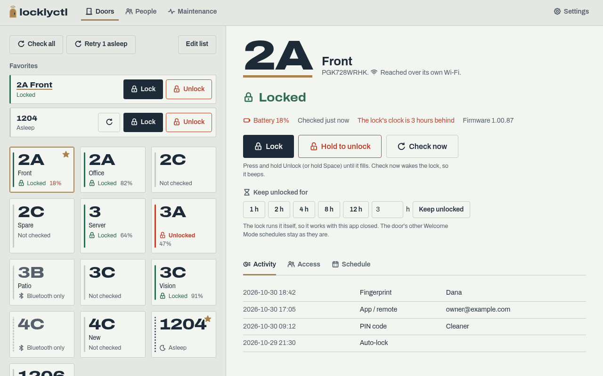
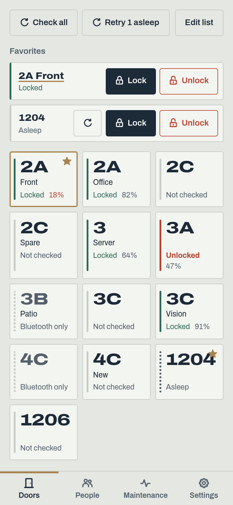
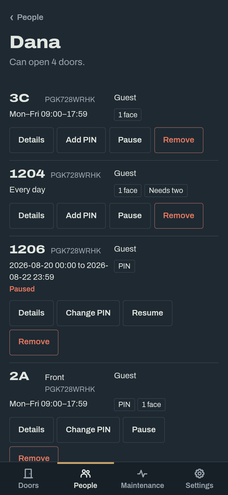
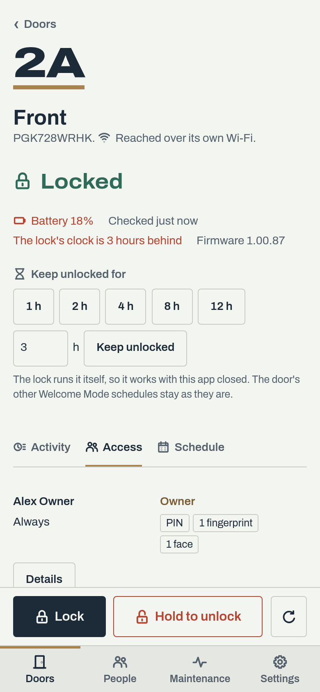
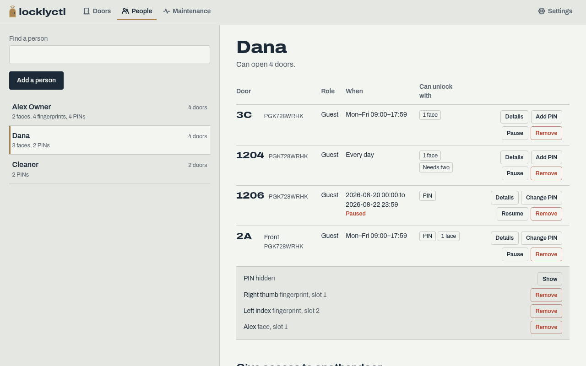
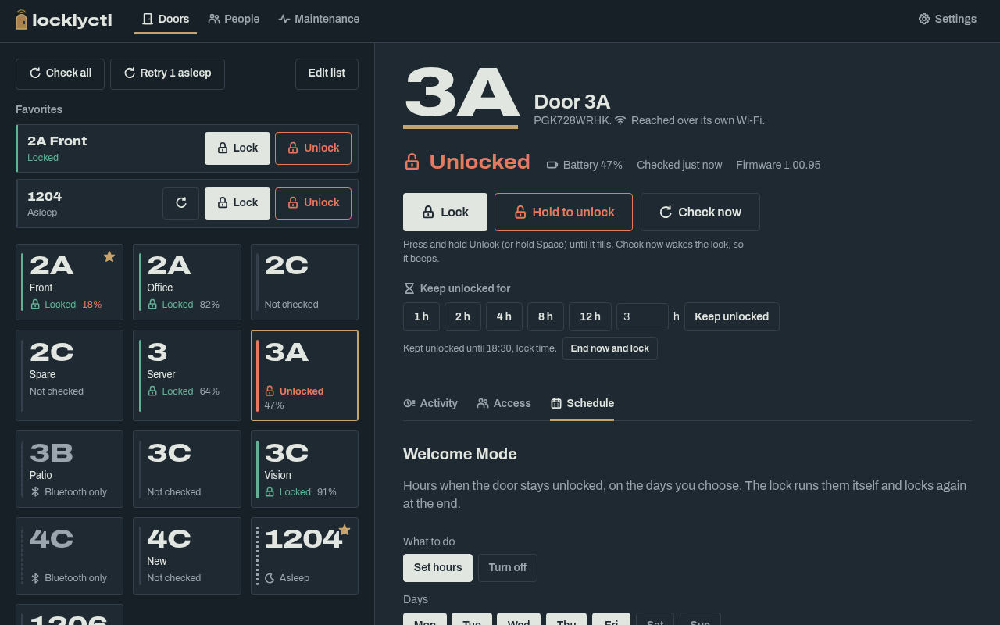
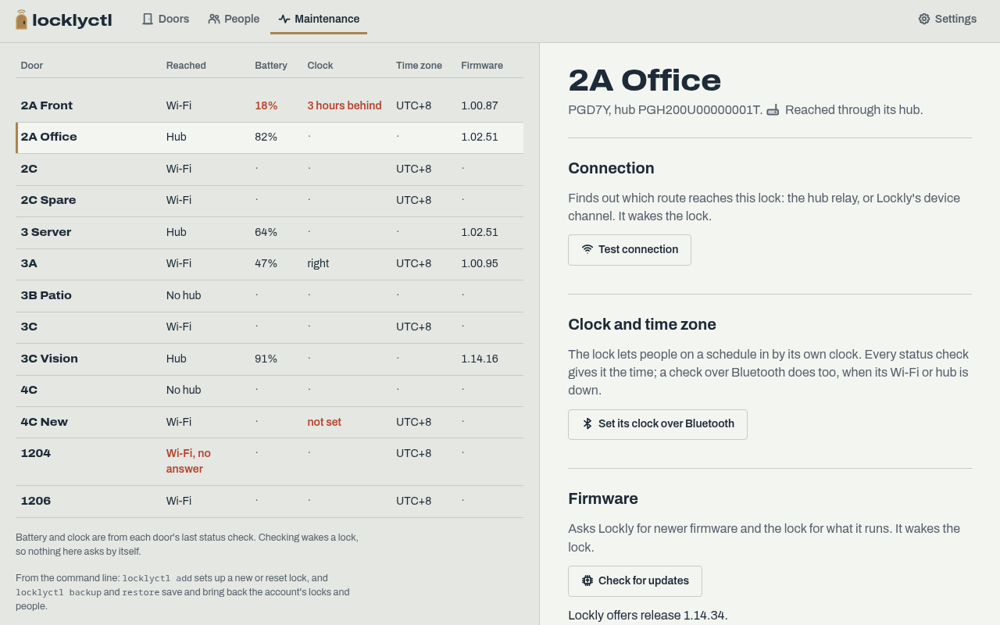

<h1><picture><source media="(prefers-color-scheme: dark)" srcset="docs/logo-dark.png"></picture></h1>

**Unofficial** control of Lockly smart locks from your computer, your phone or
an AI assistant, with no Lockly app needed. It talks to Lockly's cloud the same
way the official app does.

- **Desktop app** for Windows, macOS and Linux
- **Phone app** for Android and iOS
- **Command line**, with menus or as single commands for scripts and cron
- **MCP server**, so Claude and other AI assistants can check and run your doors

> Not affiliated with, authorised by, or endorsed by Lockly Security Inc. Use it
> only with your own account and locks. Your credentials and the keys derived
> from them stay on your device.

<p>
  
</p>
<p>
  
  
  
</p>
<p>
  
  
</p>
<p>
  
</p>

<sub>Screenshots use made-up sample data (`tests/gui/mock.js`). Rendered with
`node tests/gui/screenshots.mjs`.</sub>

## What it does

| Feature | Status |
|---|---|
| Sign in, list doors, status (silent hub cache, or live) | ✅ |
| Hide doors from the lists and put them in your own order: `hide`, `unhide`, `move`, `list --all`; in the app, "Edit list" above the doors gives each door a favorite star, ↑, ↓ and Hide, and lists hidden doors so one can be brought back | ✅ kept on this computer, per account; signed in to a private server (`--server`) the server keeps them, shared with its web console. Hiding only affects the lists: a command that names a door, and "Check all doors", still reach it. The desktop app lists doors by name until one is moved |
| The lock's own clock, from every live status check (each check also sends it the time, as the app's does) | ✅ warns when it's 2 minutes or more off, or not set: people on a schedule are let in by it. On a Visage (2026-11-13), a check carrying a time 5 minutes ahead moved its clock there before it replied, and the next ordinary check moved it back: every check that reaches it sets its clock. A reply that still shows a wrong clock gets a second check on the same route, and the result is shown, including "still wrong" |
| The lock's own time zone (0x33), which the Lockly app gives a lock when it's set up and after a firmware update: `locklyctl timezone` shows each lock's zone in the Lockly account next to this computer's, and `--sync` (or "Give it its time zone" under Maintenance) gives a lock the account's zone, then the time | ✅ sent remotely to six locks on 2026-11-14 (`timezone ... --sync`): each acknowledged the zone, then the time. Two locks that were offline fell back to Bluetooth and were out of range. The frame matches the app's field by field (SetTimeZoneCmd). Whole hours only, as the app sends it. Only models the app sends it to by model alone (the Visage among them; not the PGD7Y or the Vision). The lock's own setting can't be read (the app never reads it), so it isn't compared. It isn't sent after locklyctl's firmware installs yet. Changing the zone in the Lockly account isn't built (the app sends the whole lock record for that) |
| Bluetooth straight from this computer to a lock next to it: status checks, which also set its clock, and reaching it after a firmware install if its Wi-Fi doesn't come back | ⚠️ run on a Visage (2026-11-13): found by name, connected in 6.4 s, answered status checks; with the Auto setting it reached a Visage whose Wi-Fi was offline in 21 s. Such a door is then asked over Bluetooth first for 5 minutes, and clicking it within a minute of a Bluetooth answer doesn't connect again (the lock drops an idle Bluetooth connection after 6-8 s, so every check is a new connection). Only status checks go over Bluetooth: commands that change the lock don't yet. Needs `pip install 'locklyctl[bluetooth]'` and a Bluetooth adapter; not in the packaged apps yet |
| Connection setting: Auto (hub or Lockly's server, then Bluetooth from this computer for a status check that got no answer), Remote only, or Bluetooth only (status checks only) | ✅ the app's Settings, `--connection` on the command line; Auto is the default. An app with no Bluetooth (the packaged and phone apps) says so there instead of offering the choice |
| App lock: a passcode asked for when the app starts, which seals what locklyctl saves on the device (Settings, App lock) | ✅ tested against stand-ins, and run with the real page and backend on Linux (2026-11-15): a sealed config started at the unlock screen, refused a wrong passcode and opened with the right one in 0.15 s. ⚠️ not run on a phone, Windows or macOS. See [App lock](#app-lock) for what it does and doesn't protect |
| Lock / unlock | ✅ verified protocol (LocklyHA, real hardware) |
| Access log (last 7 days), in the Lockly app's own words | ✅ Visages: from Lockly's event log, which the lock fills over its Wi-Fi, as the Lockly app reads it (checked against a lock's own log). Other locks: from Lockly's cloud log, which only has what was uploaded to it, so often empty; reading those locks' own logs isn't done yet |
| People: everyone's access across all doors, merged by person | ✅ reads cloud and lock; merging is kept on your device |
| Visage/Vision: add a person with a PIN (always, for a while, set hours, or between dates), change PIN, remove from a door: from People, or from a door's Access tab, which lists everyone on that door | ✅ tested on a Visage: created, checked on the lock and the cloud, changed, deleted. "For a while" (4 hours to a week from now) is the between-dates record with now as its start. A person is removed from the lock first, then from Lockly's record, wherever it's done from: until 2026-11-15 the door's "Guest PINs" tab deleted only Lockly's record, which leaves the lock's own untouched |
| Visage/Vision: pause a person on one door and resume them, keeping their PIN, fingerprints and face (`suspend`, `resume`; Pause and Resume in People and in a door's Access tab) | ✅ run on a Visage from the command line (2026-11-14): the lock took the pause (a window far in the future) and the resume, kept the person's PIN, fingerprints and face through both, and got their exact schedule back. The app's buttons call the same code; they're tested against a stand-in lock. A second pause is refused: it would save the pause itself as the schedule to restore |
| Visage/Vision: remove one fingerprint, face or card | ⚠️ checked against the app and lock replies; not yet run on a lock |
| Other locks (e.g. PGD7Y): a person with a PIN, always or for a while; remove | ⚠️ Lockly's cloud takes the record; whether such a lock picks it up isn't confirmed. These locks don't keep people the way a Visage does, so changing a PIN and pausing aren't offered for them |
| Welcome Mode, 8-slot `0x9B` (Visage, Vision): read, set, off | ✅ tested on a Visage (set, read back, restore). Set asks how the hours start: when the first person opens the door (the Lockly app's default, and the one tested), or by itself at the start time (the entry bit a "keep unlocked" window uses, seen to work on one; not yet tried on a weekly schedule). A set or an off rewrites the lock's 8 slots but writes a running "keep unlocked" window back (tested against a stand-in lock) |
| Keep a Visage/Vision unlocked for a while (one-time `0x9B` slot that unlocks by itself) | ✅ tested on a Visage: opened within ~20 s, relocked at the end, and the lock switched the slot off. Under 24 h: past midnight (lock time) a second slot from 00:00 takes over, and the lock was seen to run such a slot the next day. Not yet seen: whether the door locks for the minute between 23:59 and 00:00 |
| Welcome Mode, single-slot `0x46` (PGD7Y and other Touch models) | ✅ read works; ⚠️ set/off checked against the app, not yet sent to a lock |
| Rain Mode `0x56`: read, on, off | ✅ tested on a Visage (on, read back, off) |
| Firmware: what Lockly offers, part by part, next to what the lock runs | ✅ checked against Lockly for a Visage, a PGD7Y, a Vision and PGH200 hubs |
| Setting up a new or reset Visage from this computer over Bluetooth, as the Lockly app does: the Activation Card's code, the admin PIN and the door's name, then the lock goes on your account (`locklyctl add`) | ⚠️ not yet run on a lock. Each frame and account call is ported from the app's setup (BindLockManager, app 3.3.4) and tested against a stand-in lock and server. A lock that isn't reset refuses (it answers F8): resetting is done at the door, and it deletes the lock's users; locklyctl never resets a lock. If a run stops after the lock took its new keys, the same command carries on. Visage only; not in the GUI yet; the app's eBadge, room and access-code steps aren't ported. The setup frames are masked only with the card's code, so someone recording the Bluetooth traffic of a setup could work out the lock's keys, with the Lockly app too |
| Firmware install over Wi-Fi (Visage and other multi-part Wi-Fi locks): front, back and Wi-Fi boards, as the app sends them over MQTT | ✅ installed and confirmed on a Visage (2026-11-13): it restarted, came back on Wi-Fi in about 3 minutes and reported every new version. An earlier run on another Visage left it offline afterwards; with this computer next to the door, the check after the restart also asks over Bluetooth and sets the clock. Checks Bluetooth first and warns if the lock is out of range. Shows each part's progress |
| Bluetooth-chip firmware over Bluetooth (Visage): the Dialog SUOTA update the app uses for that chip | ⚠️ installed on a Visage (2026-11-13): the lock acknowledged every block and the end signal and later reported the new version, but it went silent over Bluetooth for about 13 minutes first. The app updates the chip only after the other parts are current, and so does this: it refuses while any other part is behind. Checks the image's own CRC before sending |
| Firmware installs: every file downloaded and checked before anything is sent, and hard to stop once started | ⚠️ the checks and the hold are tested, not yet during a real install on a lock. Before anything goes to the lock, each file is downloaded and checked (its size against Lockly's offer, its MD5 against the server's) and kept in `~/.locklyctl/firmware`, used again while the server has the same file or when it can't be reached; run against Lockly's 1.14.34 Visage files (2026-11-14). From the first write until the install is confirmed or fails: other commands to that lock are refused; Ctrl+C has to be pressed 3 times within 5 s, and SIGTERM and a closed terminal are ignored (run in a separate process); this computer is kept from sleeping, shutting down or suspending on a closed lid (systemd-inhibit on Linux, run here; caffeinate on macOS and SetThreadExecutionState on Windows, not run); the desktop window stays open and signing out waits. The phone app refuses to quit, but the phone can still suspend it |
| Wi-Fi setup over Bluetooth (Visage): list the networks the lock sees, give it one, and follow it joining, as the app's Wi-Fi setup does, with the server settings Lockly gives the lock | ✅ brought a Visage that had been offline for months back onto Wi-Fi (2026-11-13): connected 21 s after the save, reachable through Lockly's server about a minute later |
| Wi-Fi passwords typed once: saved after a lock joins the network with one (in the OS keyring, else the owner-only config file), forgotten when a lock calls a saved one wrong, and otherwise taken from this computer's own saved network. Networks are offered in this order: those a lock has joined before (locklyctl saved their password), the one this computer is on, others this computer has saved, then by signal; only one of the first two kinds is preselected. When a router names each band ("Home" and "Home-5G") and this computer is on the 5 GHz name, the 2.4 GHz name counts as the one it's on; two names that differ by more than the band aren't matched. Only networks from the lock's own scan are offered, and the Visage's Wi-Fi chip (Renesas DA16200) is 2.4 GHz only, so a 5 GHz-only network never appears | ⚠️ saving in the GNOME keyring and reading a saved network from NetworkManager were run on Linux (2026-11-14), not yet in a setup on a lock. macOS (the keychain's Wi-Fi item, after macOS asks for an administrator's password) and Windows (`netsh wlan export profile key=clear`, which gives the password only when Windows allows it for that user) are tested against stand-ins only, and so is finding which network a Mac or Windows PC is on (macOS 15 and later reportedly hide the name; then that step is skipped). Phones can't read the system's saved networks. Passwords are never logged, printed or sent to the GUI's page |
| Slot locks (e.g. PGD7Y): PIN `0x4B`, list `0x50`, delete `0x4D` | ⚠️ checked against the app; not yet working on a lock |
| Face enrolment `0x7D` + `0x92` (Visage), fingerprint capture `0x7D` | ⚠️ checked against the app; needs someone at the lock, not yet tried |

Commands reach a lock through its hub (`senddata` relay) or, for Wi-Fi locks
like the Visage, Lockly's MQTT device channel. With the Auto connection
setting, a status check that gets no answer that way is tried over Bluetooth
from this computer when the lock is in range. Locks with no hub are listed,
but the desktop app doesn't check or control them yet.

## Desktop app

Four views. **Doors** and **People** are for every day; **Maintenance** is for
the locks themselves; **Settings** is for the app.

- **Doors.** Every door is a plate showing its state. Select one to lock it,
  *hold to unlock* (press and hold until the button fills, so a stray click
  can't open a door), and see its **Activity**, its **Access** (everyone who
  can open it, with the same changes as People) and its **Schedule**
  (Welcome Mode hours and Rain Mode). **Keep unlocked for** 1 to 23 hours
  (Visage, Vision) sets a one-time Welcome Mode window that the lock runs and
  ends by itself; a new one replaces the last. Above the plates, **Check
  all** asks every door, **Retry asleep** asks again the ones that didn't
  answer, and **Edit list** turns the plates into rows to star a door (it
  joins **Favorites** at the top, where Lock and Unlock are a single tap
  each, without the hold), move it or hide it.
- **People.** Everyone who can get in, across every door: give access, change
  a PIN, pause and resume, remove.
- **Maintenance.** One table of every door's route, battery, clock, time zone
  and firmware, from what's already known: opening it wakes no lock. For the
  door you select: test the connection, set the clock over Bluetooth, give
  it its time zone, give it a Wi-Fi network, check for newer firmware and
  install it. A door is only offered what it has (no Wi-Fi setup for a lock
  without Wi-Fi), and a job the app can't do where it runs (Bluetooth, in
  the packaged apps) is explained in a line instead of offered as a button.
- **Settings.** The account and sign out, how doors are reached, and the
  version.

What goes where: anything that needs Bluetooth or someone at the door, changes
a lock's firmware, network or clock, or shows protocol detail is under
Maintenance. A form not yet tried on a lock (the single-schedule Welcome Mode)
carries a caution and a Preview where it appears.

- **Windows / macOS:** download `locklyctl-windows.zip` or `locklyctl-macos.zip`
  from the latest [*Build apps*](../../actions/workflows/build.yml) run, or from
  a [release](../../releases). The builds are unsigned: on macOS right-click
  `locklyctl.app` → *Open* the first time; on Windows choose *More info* → *Run
  anyway* if SmartScreen warns. The macOS build is for Apple silicon.
- **From source, any OS:** `./gui.sh` sets everything up on first run and opens
  the app. By hand: `pip install -e '.[gui,keyring]'`, then `locklyctl-gui`.
  On Linux this uses pywebview's Qt backend, or WebKitGTK if PyGObject is
  installed.
- **In your web browser:** `locklyctl-gui --browser` serves the app on
  `127.0.0.1` behind a one-time token and opens it, with no pywebview needed.

## Phone app (Android, iOS)

The same app on your phone. It runs locklyctl's Python code inside the app
(BeeWare Briefcase and Toga) and shows the desktop page in the phone's web
view.

- **Android:** download `locklyctl-android.apk` from the latest *Build apps*
  run or a release, open it on the phone and allow installing from that
  source.
- **iOS:** download `locklyctl-ios-unsigned.ipa` and install it with
  Sideloadly or AltStore (Windows or macOS), which sign it with your Apple ID.
  A free Apple ID works, but the app then has to be reinstalled every 7 days.
  No Mac needed; see [mobile/README.md](mobile/README.md).

On a phone the four views are a bar at the bottom, and a view shows its list
or one item at a time, with a way back. A door's Lock and Hold to unlock stay
pinned at the bottom edge, and everything tapped is at least 44 px tall. The
phone apps have no Bluetooth yet, so Maintenance there offers the jobs that
go through a hub or Lockly's server and says so for the rest.

Phones have no keyring, so a remembered sign-in is kept in the app's private
storage, which other apps can't read.

## App lock

In **Settings**, **App lock** sets a passcode (4 characters or more: digits,
letters or both). From then on locklyctl asks for it when it starts, and the
file it saves on the device is sealed with it: the remembered sign-in, saved
Wi-Fi passwords, favorites, the door list's order, merged people and paused
people's schedules. **Lock now** asks for it again without quitting.

- **How.** scrypt (N 65536, r 8, p 1: 64 MiB and about 0.1 s a guess on a
  2025 desktop core) turns the passcode into two keys; the config is
  encrypted with AES-256-CTR and authenticated with HMAC-SHA256, the
  construction backups use. The keys stay in memory while the app is
  unlocked; the passcode isn't kept.
- **The keyring.** Turning the lock on moves the remembered sign-in and saved
  Wi-Fi passwords out of the OS keyring into the sealed file, and keeps new
  ones there: the desktop session opens the keyring without the passcode.
  Turning it off moves the sign-in back.
- **Wrong passcodes.** The fifth in a row starts a 30 s wait that doubles
  with each further one, up to 15 minutes, and survives a restart.
- **Forgotten.** Nothing recovers it. "Forgot the passcode?" on the unlock
  screen erases what locklyctl saved on the device; the locks and the Lockly
  account aren't touched, and you sign in again.
- **Command line and MCP.** Both use the same file, so with the lock on the
  menus and commands ask for the passcode at a terminal. Where nothing can
  ask (cron, `locklyctl-mcp`), give `--passcode-file FILE` or set
  `LOCKLYCTL_PASSCODE_FILE`: the file's first line is the passcode, and
  anyone who can read that file can open the saved data.

What it doesn't protect:

- **A short PIN against a copied file.** At 0.104 s a guess (measured on one
  core of a 2025 desktop), every 4-digit PIN takes 17 minutes and every
  6-digit PIN 29 hours; more cores divide that. The wait after wrong
  passcodes only slows guessing in the app. A long passcode is what stops
  someone who has the file.
- **An app that's open.** Once unlocked it stays unlocked until it's quit or
  **Lock now** is pressed: it doesn't lock by itself after a while, and a
  phone keeps an app open in the background.
- **Other files.** The log (`locklyctl.log`: status and error codes, device
  IDs and firmware progress, but no password, PIN, master code or sign-in),
  downloaded firmware, and backups (sealed with their own passphrase) aren't
  part of it. Data written before the lock was turned on may still be
  recoverable from the disk.

## AI assistants (MCP)

`locklyctl-mcp` is a [Model Context Protocol](https://modelcontextprotocol.io)
server. Sign in once with `locklyctl` (choose to stay signed in), then add it
to your assistant. For Claude Code:

```bash
pip install -e '.[mcp,keyring]'
claude mcp add locklyctl -- "$(command -v locklyctl-mcp)"
```

For Claude Desktop, add this to `claude_desktop_config.json`:

```json
{ "mcpServers": { "locklyctl": { "command": "/full/path/to/locklyctl-mcp" } } }
```

By default it can only look and lock: `list_doors`, `check_door`,
`door_activity`, `list_people`, `read_door_modes`, `check_firmware` and `lock_door`. Two flags add
more:

| Flag | Adds |
|---|---|
| `--allow-writes` | `grant_access`, `change_pin`, `revoke_access`, `turn_off_welcome_mode`, `end_keep_unlocked`, `set_rain_mode` |
| `--allow-unlock` | `unlock_door` |
| both | `set_welcome_mode` (with `unlock_by_itself` to choose how the hours start) and `keep_unlocked_for`, since both keep a door unlocked |

Tools a flag doesn't allow aren't offered at all, so the assistant never sees
them. Existing PINs are never returned; a PIN the server creates is returned
once, in the reply that created it. Installing firmware isn't a tool under
any flag: it's in the desktop app and the command line only.

## Command line

```bash
./run.sh                    # sets up a venv on first run, then opens the menus
```

or `pip install -e '.[keyring]'` and run `locklyctl`. Requires Python 3.10+.
Sign in, then pick a door and an action from the menus. A door's menu follows
the app's groups: Status, Unlock, Lock, Keep unlocked and Activity first, then
People and PINs, Schedule, Maintenance and Door list as menus of their own.
If you stay signed in,
the credential goes to the OS keyring (with the `keyring` extra), otherwise to
`~/.locklyctl/config.json` (owner-only). It's equivalent to your password, so
use `--logout` on shared machines. `--debug` prints protocol logging.
`--connection auto|remote|bluetooth` overrides the saved connection setting
for one run. With an [app lock](#app-lock) set, the passcode is asked for
first, or read from `--passcode-file FILE`.

Once a login is saved, single actions run without the menus. `locklyctl --help`
lists them in the same groups:

```bash
# Doors
locklyctl list [--json]                 # doors + silent hub-cached status
locklyctl list --all                    # hidden doors too, marked
locklyctl status "Office" [--live] [--json]
locklyctl lock "Office"
locklyctl unlock "Office" --yes         # --yes required when nothing can ask
locklyctl keep "Front" 2 --yes          # unlocked for 2 hours; the lock ends it by itself
locklyctl keep "Front" --end            # end that now, and lock
locklyctl activity "Front" [--json]     # the last 7 days, newest first
locklyctl welcome "Front" set --days weekdays --start 08:00 --end 18:00 --send
locklyctl welcome "Front" set --days sat --start 09:00 --end 12:00 --entry auto --send
locklyctl welcome "Front" off --send
locklyctl rain "Office" on --send

# People
locklyctl people                        # everyone, door by door (PINs are never printed)
locklyctl people "Front" [--json]       # who can open one door
locklyctl suspend "Front" "Dana" --yes  # pause a person: their PIN, fingerprints and face stay
locklyctl resume "Front" "Dana" --yes   # their schedule back, as it was

# Maintenance
locklyctl timezone                      # each lock's time zone in the account, and this computer's
locklyctl timezone "Front" --sync       # give it its time zone, then the time (wakes it)
locklyctl wifi "Front"                  # Wi-Fi networks the lock sees (over Bluetooth)
locklyctl wifi "Front" --ssid "Home"    # give it a network: the saved password, this computer's, or asks
locklyctl wifi --ssid "Home" --forget   # forget the password saved for a network
locklyctl firmware "Front" [--install] # newer firmware; --install sends it over Wi-Fi
locklyctl firmware "Front" --bluetooth-chip  # the Bluetooth chip, over Bluetooth from here
locklyctl add                           # locks in Bluetooth range that aren't on your account
locklyctl add PGK728WRHK004321          # set that one up: asks for the card's code, a name, a PIN
locklyctl backup doors.backup           # locks + people (keys and PINs) to a file sealed with a passphrase
locklyctl --server https://lock.example.com restore doors.backup   # into a private server; merged

# This computer
locklyctl gui                           # the desktop app
locklyctl hide "Office"                 # leave it out of the lists; commands still reach it
locklyctl unhide "Office"
locklyctl move "Office" --up            # or --down [N], --top, --bottom, --to 3
```

### Backups and moving to a private server

`backup FILE` writes the account's locks, with their master codes, and the
people on them, with their PINs, to one file sealed with a passphrase (scrypt,
then AES-256-CTR and HMAC-SHA256; `--no-encrypt` writes plain JSON and says
so). It never overwrites a file and writes it owner-only. Signed in to Lockly,
each Visage's people are read from the lock itself, which wakes it: the slot,
PIN and exact schedule (weekly hours included), named from Lockly's cloud.
Lockly's own list has no reliable slot numbers. A person `suspend` switched off
comes back with their saved schedule, still switched off. Other models are
carried as locks only, since a server pushes only Visage-style (0x73) records.
Fingerprints and faces stay on the lock. Signed in to a private server
(`--server`), the backup comes from the server, with its locks' MQTT logins.

`restore FILE` (needs `--server`) brings a backup into that server, merged by
lock: nothing there is deleted, and a lock another account on the server has is
left alone and reported. `--replace` makes the account exactly the backup's,
deleting the rest, after asking. Nothing is sent to the locks: they already
hold these records. The format is the one locklyctl-mqtt's own `export` and
`import` use (its CONTRACT.md, section 4), so a backup moves either way.
✅ run end to end against two locklyctl-mqtt servers (backup from one, restore
into a new one: the second then held exactly what the first did); the reading
from a Visage is tested against a stand-in lock, not yet run on one.

A door is named by its name (case-insensitive, a unique prefix is fine) or ID.
`welcome` and `rain` only print the frame unless `--send` is given. `welcome
set --entry first` (the default, as the Lockly app) keeps the door locked at
the start time until someone opens it once; `--entry auto` unlocks it by
itself. `keep` opens a door, so like `unlock` it asks first or needs `--yes`.
`firmware --install` asks first (or needs `--yes`), refuses at 30 % battery
or less as the Lockly app does, downloads and checks every file before it
sends anything, follows the lock's progress, then waits up to 5 minutes for
the lock to report the new versions. Once it has started, Ctrl+C has to be
pressed 3 times within 5 seconds to stop it. Exit status: 0 ok, 1 the
lock or cloud failed, 2 usage error.

## Building

Every push to `master` runs [`.github/workflows/build.yml`](.github/workflows/build.yml):
tests (including a run with the iOS app's pure-Python ciphers), then the
Windows and macOS apps (PyInstaller), the Android APK, and the iOS Simulator
app and unsigned iPhone `.ipa` (Briefcase, then `xcodebuild`). Pushing a `v*`
tag also attaches them to a release.

By hand:

```bash
pip install '.[gui,keyring]' pyinstaller && pyinstaller --noconfirm packaging/locklyctl-gui.spec
pip install briefcase && briefcase package android -p debug-apk    # needs the Android SDK
```

To work on the page (`locklyctl/gui/web`: plain HTML/CSS/JS, no build step)
without a lock, serve the repo root with `python -m http.server` and open
`http://localhost:8000/locklyctl/gui/web/index.html?mock=/tests/gui/mock.js`.

## How it works / provenance

The cryptography, BLE frame building and response parsing in `protocol.py`
come from [Forcky's LocklyHA](https://github.com/Forcky/LocklyHA) (MIT, see
`LICENSE.LocklyHA`), where they were validated on real hardware. The REST/MQTT
transport, the user-management, Welcome and Rain Mode frames (`features.py`,
decoded from the Lockly Android app and tested where the table above says so),
the apps and the MCP server are new.

Recent Lockly apps insist on Bluetooth for adding users, yet a lock accepts
these commands over its hub or MQTT just like unlock, which is what lets
locklyctl manage people remotely.

Protocol reference: <https://digitalcybersoft.github.io/lockly_api_docs/>.

## Safety

- A lock's master code and UUID together can forge any command. locklyctl only
  holds them in memory while it runs.
- The remembered sign-in is as good as your Lockly password. Without an
  [app lock](#app-lock) it sits in the OS keyring, or on a phone in the app's
  private storage, readable by anything that can read those.
- Commands marked ⚠️ are correctly framed but their contents aren't proven on
  a lock. A wrong field is most likely rejected, but try them on a door you
  can physically reach first.

## Licence

MIT (new code). `protocol.py` and `certs/` derive from LocklyHA (MIT). The apps
bundle the Archivo font (SIL OFL 1.1). See `NOTICE`.
