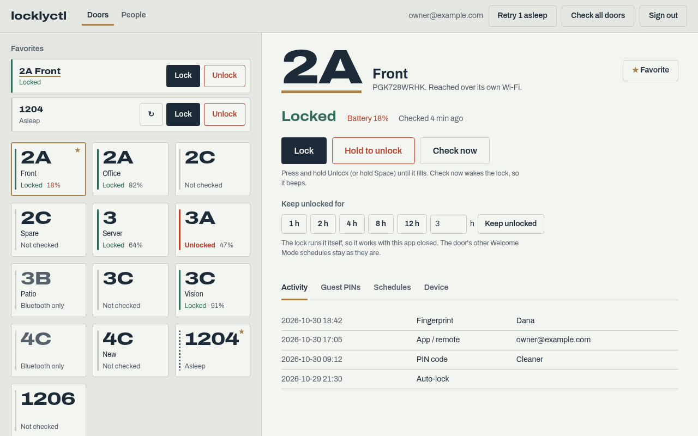
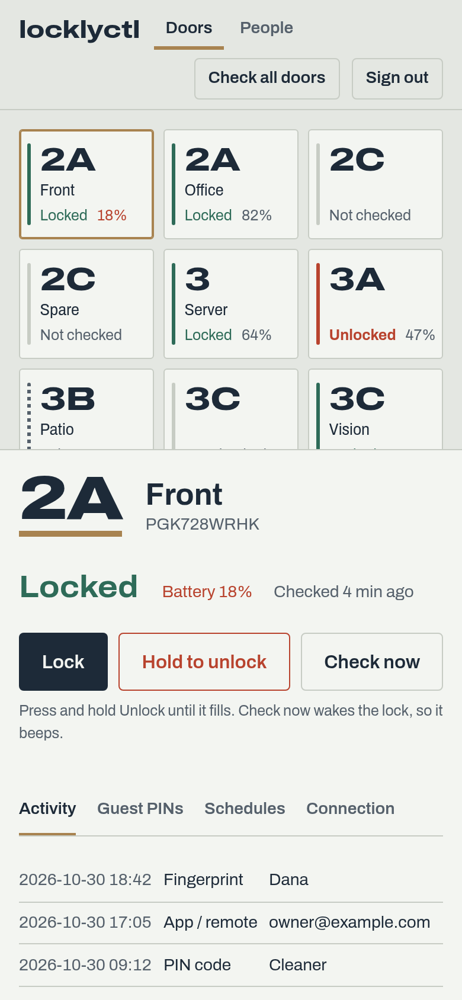
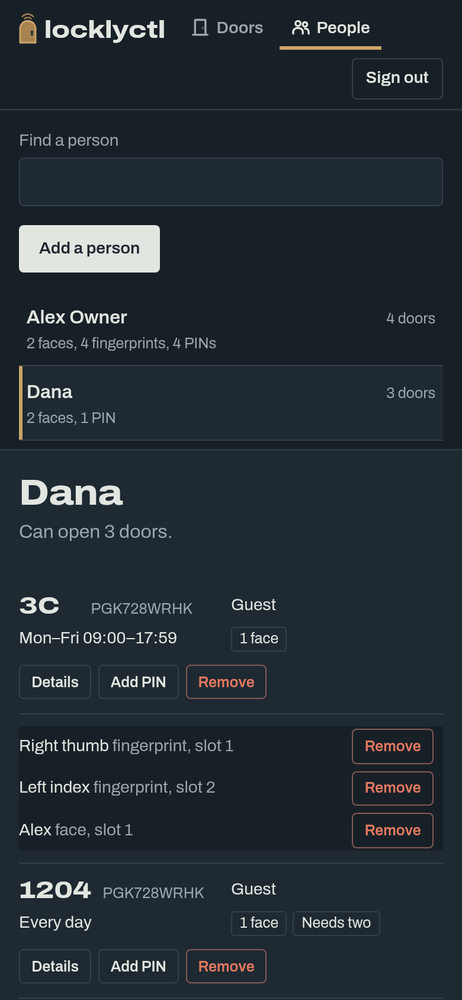
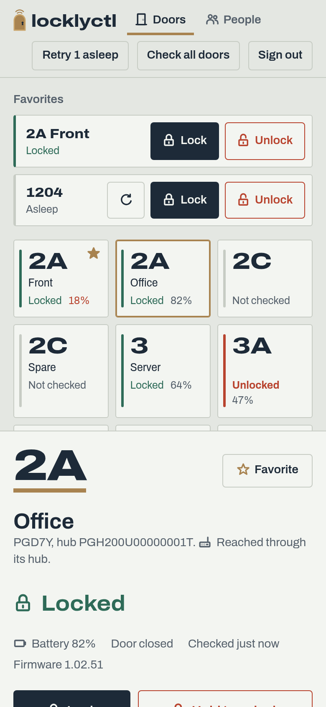
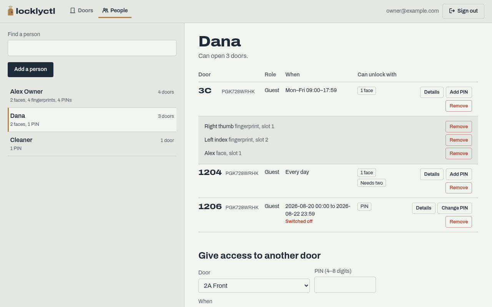
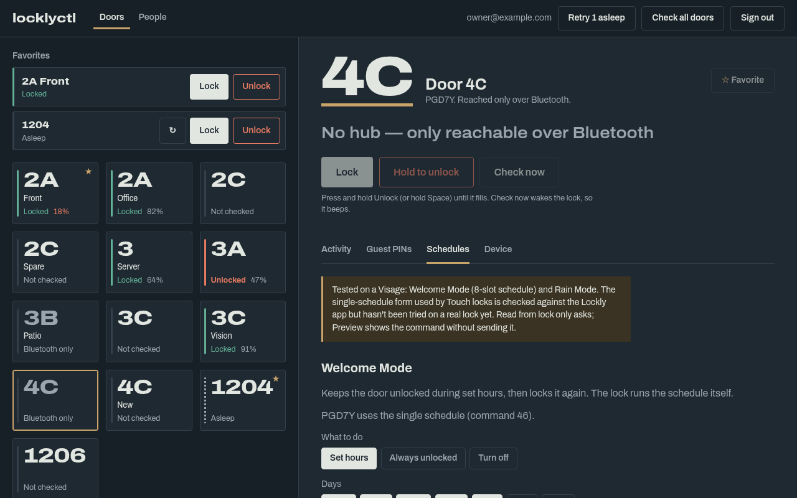

<h1><picture><source media="(prefers-color-scheme: dark)" srcset="docs/logo-dark.png"></picture></h1>

**Unofficial** control of Lockly smart locks from your computer, your phone or
an AI assistant, with no Lockly app needed. It talks to Lockly's cloud the same
way the official app does.

- **Desktop app** for Windows, macOS and Linux
- **Phone app** for Android and iOS
- **Command line**, with menus or as single commands for scripts and cron
- **MCP server**, so Claude and other AI assistants can check and run your doors

> Not affiliated with, authorised by, or endorsed by Lockly Security Inc. Use it
> only with your own account and locks. Your credentials and the keys derived
> from them stay on your device.

<p>
  
</p>
<p>
  
  
  
</p>
<p>
  
  
</p>

<sub>Screenshots use made-up sample data (`tests/gui/mock.js`). Rendered with
`node tests/gui/screenshots.mjs`.</sub>

## What it does

| Feature | Status |
|---|---|
| Sign in, list doors, status (silent hub cache, or live) | ✅ |
| The lock's own clock, from every live status check (each check also sends it the time, as the app's does) | ✅ warns when it's 2 minutes or more off, or not set: people on a schedule are let in by it. On a Visage (2026-11-13), a check carrying a time 5 minutes ahead moved its clock there before it replied, and the next ordinary check moved it back: every check that reaches it sets its clock. A reply that still shows a wrong clock gets a second check on the same route, and the result is shown, including "still wrong" |
| Bluetooth straight from this computer to a lock next to it: status checks, which also set its clock, and reaching it after a firmware install if its Wi-Fi doesn't come back | ⚠️ run on a Visage (2026-11-13): found by name, connected in 6.4 s, answered status checks; with the Auto setting it reached a Visage whose Wi-Fi was offline in 21 s. Such a door is then asked over Bluetooth first for 5 minutes, and clicking it within a minute of a Bluetooth answer doesn't connect again (the lock drops an idle Bluetooth connection after 6-8 s, so every check is a new connection). Only status checks go over Bluetooth: commands that change the lock don't yet. Needs `pip install 'locklyctl[bluetooth]'` and a Bluetooth adapter; not in the packaged apps yet |
| Connection setting: Auto (hub or Lockly's server, then Bluetooth from this computer for a status check that got no answer), Remote only, or Bluetooth only (status checks only) | ✅ desktop app's Device tab, `--connection` on the command line; Auto is the default |
| Lock / unlock | ✅ verified protocol (LocklyHA, real hardware) |
| Access log (last 7 days), in the Lockly app's own words | ✅ Visages: from Lockly's event log, which the lock fills over its Wi-Fi, as the Lockly app reads it (checked against a lock's own log). Other locks: from Lockly's cloud log, which only has what was uploaded to it, so often empty; reading those locks' own logs isn't done yet |
| People: everyone's access across all doors, merged by person | ✅ reads cloud and lock; merging is kept on your device |
| Visage/Vision: add a person with a PIN (always, set hours, or between dates), change PIN, remove from a door | ✅ tested on a Visage: created, checked on the lock and the cloud, changed, deleted |
| Visage/Vision: remove one fingerprint, face or card | ⚠️ checked against the app and lock replies; not yet run on a lock |
| Guest PIN codes: add, list, delete | ✅ on Visage/Vision written to the lock; PGD7Y unverified |
| Welcome Mode, 8-slot `0x9B` (Visage, Vision): read, set, off | ✅ tested on a Visage (set, read back, restore). Set writes "first entry" slots: the door stays locked until someone opens it once |
| Keep a Visage/Vision unlocked for a while (one-time `0x9B` slot that unlocks by itself) | ✅ tested on a Visage: opened within ~20 s, relocked at the end, and the lock switched the slot off. Under 24 h: past midnight (lock time) a second slot from 00:00 takes over, and the lock was seen to run such a slot the next day. Not yet seen: whether the door locks for the minute between 23:59 and 00:00 |
| Welcome Mode, single-slot `0x46` (PGD7Y and other Touch models) | ✅ read works; ⚠️ set/off checked against the app, not yet sent to a lock |
| Rain Mode `0x56`: read, on, off | ✅ tested on a Visage (on, read back, off) |
| Firmware: what Lockly offers, part by part, next to what the lock runs | ✅ checked against Lockly for a Visage, a PGD7Y, a Vision and PGH200 hubs |
| Firmware install over Wi-Fi (Visage and other multi-part Wi-Fi locks): front, back and Wi-Fi boards, as the app sends them over MQTT | ✅ installed and confirmed on a Visage (2026-11-13): it restarted, came back on Wi-Fi in about 3 minutes and reported every new version. An earlier run on another Visage left it offline afterwards; with this computer next to the door, the check after the restart also asks over Bluetooth and sets the clock. Checks Bluetooth first and warns if the lock is out of range. Shows each part's progress |
| Bluetooth-chip firmware over Bluetooth (Visage): the Dialog SUOTA update the app uses for that chip | ⚠️ installed on a Visage (2026-11-13): the lock acknowledged every block and the end signal and later reported the new version, but it went silent over Bluetooth for about 13 minutes first. The app updates the chip only after the other parts are current, and so does this: it refuses while any other part is behind. Checks the image's own CRC before sending |
| Firmware installs: every file downloaded and checked before anything is sent, and hard to stop once started | ⚠️ the checks and the hold are tested, not yet during a real install on a lock. Before anything goes to the lock, each file is downloaded and checked (its size against Lockly's offer, its MD5 against the server's) and kept in `~/.locklyctl/firmware`, used again while the server has the same file or when it can't be reached; run against Lockly's 1.14.34 Visage files (2026-11-14). From the first write until the install is confirmed or fails: other commands to that lock are refused; Ctrl+C has to be pressed 3 times within 5 s, and SIGTERM and a closed terminal are ignored (run in a separate process); this computer is kept from sleeping, shutting down or suspending on a closed lid (systemd-inhibit on Linux, run here; caffeinate on macOS and SetThreadExecutionState on Windows, not run); the desktop window stays open and signing out waits. The phone app refuses to quit, but the phone can still suspend it |
| Wi-Fi setup over Bluetooth (Visage): list the networks the lock sees, give it one, and follow it joining, as the app's Wi-Fi setup does, with the server settings Lockly gives the lock | ✅ brought a Visage that had been offline for months back onto Wi-Fi (2026-11-13): connected 21 s after the save, reachable through Lockly's server about a minute later. The password is never logged or stored |
| Slot locks (e.g. PGD7Y): PIN `0x4B`, list `0x50`, delete `0x4D` | ⚠️ checked against the app; not yet working on a lock |
| Face enrolment `0x7D` + `0x92` (Visage), fingerprint capture `0x7D` | ⚠️ checked against the app; needs someone at the lock, not yet tried |

Commands reach a lock through its hub (`senddata` relay) or, for Wi-Fi locks
like the Visage, Lockly's MQTT device channel. With the Auto connection
setting, a status check that gets no answer that way is tried over Bluetooth
from this computer when the lock is in range. Locks with no hub are listed,
but the desktop app doesn't check or control them yet.

## Desktop app

Every door is a plate showing its state. Select one to lock it, *hold to
unlock* (press and hold until the button fills, so a stray click can't open a
door), and see its access log, guest PINs, Welcome/Rain Mode and a connection
test. Star a door to pin it to **Favorites** at the top of the list, where
Lock and Unlock are a single tap each, without the hold. **Keep unlocked for**
1 to 23 hours (Visage, Vision) sets a one-time Welcome Mode window that the
lock runs and ends by itself; a new one replaces the last. Doors that didn't
answer can be asked again with **Retry asleep**. The **Device** tab tests the
connection, checks for newer firmware and, on a Visage, installs it over
Wi-Fi. The **People** view
shows everyone who can get in, across every door, and lets you give, change
and take away access.

- **Windows / macOS:** download `locklyctl-windows.zip` or `locklyctl-macos.zip`
  from the latest [*Build apps*](../../actions/workflows/build.yml) run, or from
  a [release](../../releases). The builds are unsigned: on macOS right-click
  `locklyctl.app` → *Open* the first time; on Windows choose *More info* → *Run
  anyway* if SmartScreen warns. The macOS build is for Apple silicon.
- **From source, any OS:** `./gui.sh` sets everything up on first run and opens
  the app. By hand: `pip install -e '.[gui,keyring]'`, then `locklyctl-gui`.
  On Linux this uses pywebview's Qt backend, or WebKitGTK if PyGObject is
  installed.
- **In your web browser:** `locklyctl-gui --browser` serves the app on
  `127.0.0.1` behind a one-time token and opens it, with no pywebview needed.

## Phone app (Android, iOS)

The same app on your phone. It runs locklyctl's Python code inside the app
(BeeWare Briefcase and Toga) and shows the desktop page in the phone's web
view.

- **Android:** download `locklyctl-android.apk` from the latest *Build apps*
  run or a release, open it on the phone and allow installing from that
  source.
- **iOS:** download `locklyctl-ios-unsigned.ipa` and install it with
  Sideloadly or AltStore (Windows or macOS), which sign it with your Apple ID.
  A free Apple ID works, but the app then has to be reinstalled every 7 days.
  No Mac needed; see [mobile/README.md](mobile/README.md).

Phones have no keyring, so a remembered sign-in is kept in the app's private
storage, which other apps can't read.

## AI assistants (MCP)

`locklyctl-mcp` is a [Model Context Protocol](https://modelcontextprotocol.io)
server. Sign in once with `locklyctl` (choose to stay signed in), then add it
to your assistant. For Claude Code:

```bash
pip install -e '.[mcp,keyring]'
claude mcp add locklyctl -- "$(command -v locklyctl-mcp)"
```

For Claude Desktop, add this to `claude_desktop_config.json`:

```json
{ "mcpServers": { "locklyctl": { "command": "/full/path/to/locklyctl-mcp" } } }
```

By default it can only look and lock: `list_doors`, `check_door`,
`door_activity`, `list_people`, `read_door_modes`, `check_firmware` and `lock_door`. Two flags add
more:

| Flag | Adds |
|---|---|
| `--allow-writes` | `grant_access`, `change_pin`, `revoke_access`, `turn_off_welcome_mode`, `end_keep_unlocked`, `set_rain_mode` |
| `--allow-unlock` | `unlock_door` |
| both | `set_welcome_mode` and `keep_unlocked_for`, since both keep a door unlocked |

Tools a flag doesn't allow aren't offered at all, so the assistant never sees
them. Existing PINs are never returned; a PIN the server creates is returned
once, in the reply that created it. Installing firmware isn't a tool under
any flag: it's in the desktop app and the command line only.

## Command line

```bash
./run.sh                    # sets up a venv on first run, then opens the menus
```

or `pip install -e '.[keyring]'` and run `locklyctl`. Requires Python 3.10+.
Sign in, then pick a door and an action from the menus. If you stay signed in,
the credential goes to the OS keyring (with the `keyring` extra), otherwise to
`~/.locklyctl/config.json` (owner-only). It's equivalent to your password, so
use `--logout` on shared machines. `--debug` prints protocol logging.
`--connection auto|remote|bluetooth` overrides the saved connection setting
for one run.

Once a login is saved, single actions run without the menus:

```bash
locklyctl list [--json]                 # doors + silent hub-cached status
locklyctl status "Office" [--live] [--json]
locklyctl lock "Office"
locklyctl unlock "Office" --yes         # --yes required when nothing can ask
locklyctl welcome "Front" set --days weekdays --start 08:00 --end 18:00 --send
locklyctl welcome "Front" off --send
locklyctl rain "Office" on --send
locklyctl firmware "Front" [--install] # newer firmware; --install sends it over Wi-Fi
locklyctl firmware "Front" --bluetooth-chip  # the Bluetooth chip, over Bluetooth from here
locklyctl wifi "Front"                  # Wi-Fi networks the lock sees (over Bluetooth)
locklyctl wifi "Front" --ssid "Home"    # give it a network; asks for the password
```

A door is named by its name (case-insensitive, a unique prefix is fine) or ID.
`welcome` and `rain` only print the frame unless `--send` is given.
`firmware --install` asks first (or needs `--yes`), refuses at 30 % battery
or less as the Lockly app does, downloads and checks every file before it
sends anything, follows the lock's progress, then waits up to 5 minutes for
the lock to report the new versions. Once it has started, Ctrl+C has to be
pressed 3 times within 5 seconds to stop it. Exit status: 0 ok, 1 the
lock or cloud failed, 2 usage error.

## Building

Every push to `master` runs [`.github/workflows/build.yml`](.github/workflows/build.yml):
tests (including a run with the iOS app's pure-Python ciphers), then the
Windows and macOS apps (PyInstaller), the Android APK, and the iOS Simulator
app and unsigned iPhone `.ipa` (Briefcase, then `xcodebuild`). Pushing a `v*`
tag also attaches them to a release.

By hand:

```bash
pip install '.[gui,keyring]' pyinstaller && pyinstaller --noconfirm packaging/locklyctl-gui.spec
pip install briefcase && briefcase package android -p debug-apk    # needs the Android SDK
```

To work on the page (`locklyctl/gui/web`: plain HTML/CSS/JS, no build step)
without a lock, serve the repo root with `python -m http.server` and open
`http://localhost:8000/locklyctl/gui/web/index.html?mock=/tests/gui/mock.js`.

## How it works / provenance

The cryptography, BLE frame building and response parsing in `protocol.py`
come from [Forcky's LocklyHA](https://github.com/Forcky/LocklyHA) (MIT, see
`LICENSE.LocklyHA`), where they were validated on real hardware. The REST/MQTT
transport, the user-management, Welcome and Rain Mode frames (`features.py`,
decoded from the Lockly Android app and tested where the table above says so),
the apps and the MCP server are new.

Recent Lockly apps insist on Bluetooth for adding users, yet a lock accepts
these commands over its hub or MQTT just like unlock, which is what lets
locklyctl manage people remotely.

Protocol reference: <https://digitalcybersoft.github.io/lockly_api_docs/>.

## Safety

- A lock's master code and UUID together can forge any command. locklyctl only
  holds them in memory while it runs.
- Commands marked ⚠️ are correctly framed but their contents aren't proven on
  a lock. A wrong field is most likely rejected, but try them on a door you
  can physically reach first.

## Licence

MIT (new code). `protocol.py` and `certs/` derive from LocklyHA (MIT). The apps
bundle the Archivo font (SIL OFL 1.1). See `NOTICE`.
